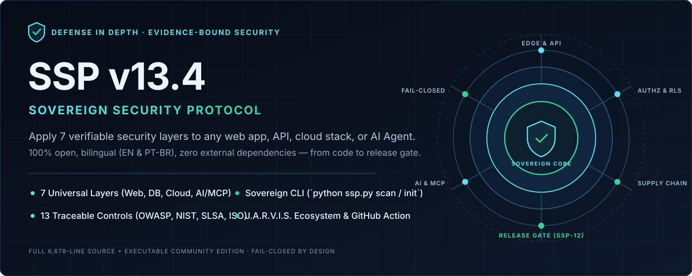
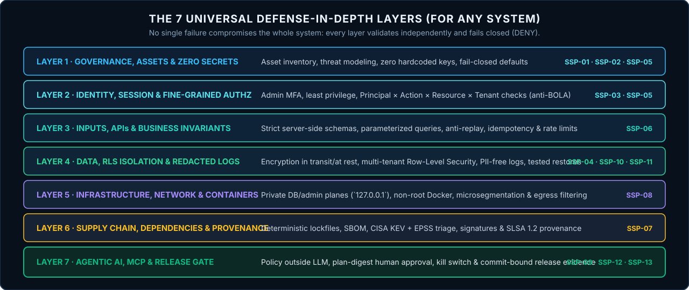
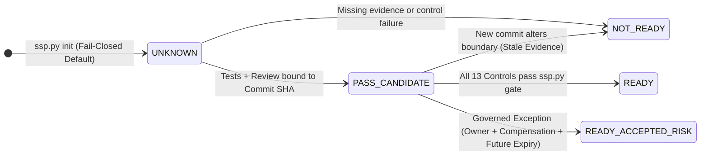

# Sovereign Security Protocol (SSP v13.4) — Layered Security for Any System

<p align="center">
  
</p>

<p align="center">
  <strong>Open Defense-in-Depth Framework, 13 Traceable Controls, Multi-Stack Playbooks, and Zero-Dependency CLI Engine for Web Apps, APIs, Databases, Cloud/Docker, and AI Agents (MCP)</strong>
</p>

<p align="center">
  <a href="https://github.com/robertoatila/sovereign-security-protocol/actions/workflows/ci.yml"></a>
  <a href="protocol/v13.4/PROTOCOLO_INTEGRAL_v13.4_PT-BR.md"></a>
  <a href="CHANGELOG.md"></a>
  <a href="ssp.py"></a>
  <a href="docs/en/layers-by-system.md"></a>
  <a href="https://github.com/robertoatila/jarvis-skill-registry"></a>
  <a href="LICENSE"></a>
</p>

<p align="center">
  <a href="README.md">🇧🇷 <strong>Ler em Português (`README.md`)</strong></a> · 🇺🇸 <strong>English</strong>
</p>

<p align="center">
  <a href="protocol/v13.4/SSP_v13.4_FULL_EN_COMMUNITY.md"><strong>📜 Full Protocol (6,678 lines)</strong></a> ·
  <a href="#-60-second-quickstart-apply-to-any-project"><strong>⚡ 60s Quickstart</strong></a> ·
  <a href="docs/en/layers-by-system.md"><strong>🛡️ 7-Layer Code Manual</strong></a> ·
  <a href="docs/en/protocol.md"><strong>📋 The 13 Controls</strong></a> ·
  <a href="docs/en/ecosystem-and-50k-references.md"><strong>🧠 J.A.R.V.I.S. &amp; 50k+★ Benchmarks</strong></a> ·
  <a href="run_tests.py"><strong>✅ Test Suite</strong></a>
</p>

---

## 📜 Direct Access to the Unabridged SSP v13.4.0 Text

- **🇧🇷 Authoritative Portuguese Source (6,678 lines):** **[`protocol/v13.4/PROTOCOLO_INTEGRAL_v13.4_PT-BR.md`](protocol/v13.4/PROTOCOLO_INTEGRAL_v13.4_PT-BR.md)** *(reproduced byte-for-byte from the pinned commit in [`provenance.md`](docs/research/provenance.md), cryptographically verified via SHA-256).*
- **🇺🇸 Full English Community Translation:** **[`protocol/v13.4/SSP_v13.4_FULL_EN_COMMUNITY.md`](protocol/v13.4/SSP_v13.4_FULL_EN_COMMUNITY.md)** *(non-canonical automated draft awaiting human technical review; the PT-BR source governs any wording discrepancy).*

---

## 🌍 Can Anyone Apply SSP to Any System Using Only This Repository?

**Yes.** This repository is engineered to be **100% self-contained, free, offline, and stack-agnostic**. You do not need paid SaaS scanners, heavy `pip`/`npm` dependency trees, or cloud telemetry uploads:

| Your System Type | How to Apply Using Only This Repo | Included Ready-to-Use Artifacts |
| :--- | :--- | :--- |
| **Web Apps & APIs** *(Node/TS, Python, Java, Go, PHP, C#)* | `python ssp.py init --profile web-api --lang en` | Anti-BOLA/IDOR patterns, fail-closed boot checks, strict schemas & idempotency ([code manual](docs/en/layers-by-system.md)) |
| **Multi-Tenant SaaS & Databases** *(PostgreSQL, MySQL)* | `python ssp.py init --profile saas-multitenant --lang en` | `FORCE ROW LEVEL SECURITY` isolation, split DB roles, PII-free logs & restore drills |
| **Containers, Linux & Cloud** *(Docker, Compose, K8s, VPS)* | `python ssp.py init --profile microservice --lang en` | Fixes Docker/UFW public port bypass (`127.0.0.1`), non-root containers & egress filtering |
| **AI Agents, RAG & MCP Servers** *(OpenAI, Gemini, Claude, Local)* | `python ssp.py init --profile ai-agent-mcp --lang en` | `AI_AGENT_MANIFEST.json`, external policy checks, `SHA-256` plan-digest approval & kill-switch |
| **CLI, Mobile & Desktop Apps** *(Rust, Go, Swift, Electron, Tauri)* | `python ssp.py init --profile cli-desktop --lang en` | Deterministic lockfiles, zero hardcoded secrets, SLSA provenance & safe atomic updates |
| **GitHub CI/CD Pipelines** *(Any language)* | `uses: robertoatila/sovereign-security-protocol@main` | Drop-in Composite GitHub Action ([`action.yml`](action.yml)) in 5 lines of YAML |

---

## ⚡ 60-Second Quickstart (Apply to Any Project)

Requires only **Python 3.10+** (pure standard library — **zero `pip install`**):

```bash
# 1. Clone the repository and run the cryptographic self-diagnostic (SHA-256 + links + schemas):
git clone https://github.com/robertoatila/sovereign-security-protocol.git
cd sovereign-security-protocol
python ssp.py --doctor

# 2. Bootstrap the 7 Security Layers (.ssp/) inside ANY project on your machine:
python ssp.py init --target /path/to/your-project --profile web-api --ci --lang en

# 3. Scan your project across all 7 Defense-in-Depth Layers (100% local & offline):
python ssp.py scan --target /path/to/your-project --lang en

# 4. View terminal layer blueprints or enforce the SSP-12 Release Assurance Gate:
python ssp.py blueprint --lang en
python ssp.py gate --file /path/to/your-project/.ssp/evidence.json --target /path/to/your-project
```

### Or drop into any GitHub Actions workflow in 5 lines:

```yaml
- uses: actions/checkout@v4
- uses: robertoatila/sovereign-security-protocol@main
  with:
    mode: scan
    target: .
    lang: en
```

---

## 🛡️ Universal Architecture: The 7 Layers & 13 Controls

<p align="center">
  
</p>

The community edition distills the **9 domains** of the 6,678-line protocol into **13 auditable controls (`SSP-01` to `SSP-13`)** organized across **7 defense layers**:

| ID | Layer | Community Control | Real-World Failure Prevented | Min Lvl | Mapped Standards |
| :---: | :---: | :--- | :--- | :---: | :--- |
| **`SSP-01`** | `L1` | Scope, assets, and accountability | Unowned services, shadow dependencies, unapproved boundary drift | `L1` | NIST PM-5/CM-8 · CIS 1 · ISO A.5.8 |
| **`SSP-02`** | `L1` | Threat modeling and trust boundaries | Implicitly trusting webhooks, prompts, RAG docs, or tool outputs | `L2` | NIST RA-3 · OWASP ASVS V1 |
| **`SSP-03`** | `L2` | Identity and fine-grained AuthZ | Cross-customer data theft (**BOLA/IDOR**) and MFA-less admin access | `L2` | OWASP ASVS V2-V4 · NIST AC-3/AC-6 |
| **`SSP-04`** | `L4` | Data protection, RLS, and privacy | Multi-tenant DB leaks, unencrypted stores, and unbounded retention | `L2` | OWASP ASVS V6/V8 · NIST SC-8/SC-28 |
| **`SSP-05`** | `L1/L2` | Secure config and fail-closed behavior | Auth silently turning off on missing env vars (`Fail-Open`) & default creds | `L2` | OWASP ASVS V14 · CIS 4 · NIST CM-6 |
| **`SSP-06`** | `L3` | Inputs, APIs, and business logic | SQLi, Command Injection, client-side price tampering & race conditions | `L2` | OWASP ASVS V5/V13 · NIST SI-10 |
| **`SSP-07`** | `L6` | Dependencies and build integrity | Supply-chain tampering, missing lockfiles & exploited CVEs (**CISA KEV**) | `L2` | SLSA 1.2 · NIST SR-3 · CIS 2 |
| **`SSP-08`** | `L5` | Infrastructure, network, and containers | Docker publishing DB ports on `0.0.0.0` (bypassing UFW) & `root` containers | `L2` | NIST SC-7 · CIS 12 · ISO A.8.20 |
| **`SSP-09`** | `L7` | Agentic AI, memory, RAG, and MCP | Prompt injection escalating to shell exec, tool poisoning & cross-tenant RAG | `L3` | OWASP Agentic 2026 / LLM Top 10 |
| **`SSP-10`** | `L4` | Reliability, change, and recovery | Duplicate queue side effects, destructive migrations & untested backups | `L2` | NIST CP-4/CP-9 · CIS 11 · ISO A.8.13 |
| **`SSP-11`** | `L4` | Redacted logs, detection, and response | Plaintext tokens/passwords in logs and blind incident response | `L2` | OWASP ASVS V7 · NIST AU-2/IR-4 |
| **`SSP-12`** | `L7` | Verification and release decision | Shipping to production on stale evidence from an older git commit | `L3` | NIST CA-2/SA-11 · ISO A.8.29 |
| **`SSP-13`** | `L7` | Accessibility, obligations, and review | Overlooking GDPR/LGPD duties, WCAG 2.2 AA targets, and post-incident drift | `L1` | WCAG 2.2 AA · ISO A.5.31/A.5.36 |

---

## 📐 Formal Security Invariants (Why SSP Succeeds Where Checklists Fail)

Aligned with its sister cognitive runtime **[`J.A.R.V.I.S.`](https://github.com/robertoatila/jarvis-skill-registry)**, SSP enforces deterministic invariants:

### 1. Orthogonality Between Compiling, Scanning, and Release Readiness (`SSP-12`)
A green build or zero-finding static scan **never proves** that multi-tenant authorization works or that backups actually restore:

$$\texttt{BuildCompiles} \;\not\implies\; \texttt{ScannerClean} \;\not\implies\; \texttt{READY}$$

Every `PASS` requires `Implementation + Appropriate Verification Method + Fresh Evidence` bound to the exact **Commit SHA** and **Artifact Digest** being released.



### 2. Externalized Authority for AI Agents & MCP (`SSP-09`)
An LLM **never grants authority**. Effective authorization $\mathcal{A}_{\text{eff}}$ for any tool call or subagent delegation is computed **outside the model** via strict set intersection:

$$\mathcal{A}_{\text{eff}} = \mathcal{M}_{\text{mission}} \cap \mathcal{I}_{\text{principal}} \cap \mathcal{P}_{\text{agent}} \cap \mathcal{T}_{\text{tool}} \cap \mathcal{R}_{\text{resource/tenant}} \cap \mathcal{E}_{\text{env}} \cap \mathcal{B}_{\text{budget}}$$

High-risk mutating operations require human approval cryptographically bound to the exact `SHA-256` payload digest (`plan_digest`). If a single byte changes, consent is invalidated.

---

## 💻 Side-by-Side Patterns: ❌ Common Mistakes vs. ✅ SSP Layers

Explore copy-pasteable production patterns for Python, TypeScript/Node.js, PostgreSQL RLS, Docker, and MCP Agents in the **[7-Layer Practical Manual (`docs/en/layers-by-system.md`)](docs/en/layers-by-system.md)**:

| Real-World Scenario | ❌ Common Production Mistake | ✅ Sovereign SSP Defense Layer |
| :--- | :--- | :--- |
| **Missing Auth Env Var** | `os.getenv("REQUIRE_AUTH", "false")` silently disables authentication | **SSP-05:** Abort startup in production if critical secret/flag is unset (`Fail-Closed`) |
| **Route `GET /invoices/:id`** | Checks valid JWT only (lets Customer A read Customer B's invoice) | **SSP-03 + SSP-04:** `WHERE id = :id AND tenant_id = :tid` + PostgreSQL `FORCE RLS` |
| **Postgres/Redis in Docker** | `ports: ["5432:5432"]` bypasses host `ufw` and exposes DB to public WAN | **SSP-08:** `ports: ["127.0.0.1:5432:5432"]` + `internal: true` net + non-root `USER` |
| **AI Agent Calling MCP** | Generic `"Approve"` button or relying on system-prompt "do not delete" rules | **SSP-09:** External `PolicyEngine` + `SHA-256` plan-digest consent + hard kill-switch |

---

## 🧠 J.A.R.V.I.S. Ecosystem, Obsidian & 50k+★ Open-Source Benchmarks

- **Sister Ecosystem [`robertoatila/jarvis-skill-registry`](https://github.com/robertoatila/jarvis-skill-registry):** While this repository provides the open SSP v13.4 normative baseline, JSON schemas, multi-stack playbooks, and the standalone `ssp.py` scanner/gate, **J.A.R.V.I.S.** implements a local-first cognitive runtime featuring `PolicyEngine (R0–R5)`, deterministic UTF-8 byte context budgets (`compile_context`), `392` governed skills, and a Stdio MCP gateway. Use SSP **100% standalone** in any codebase or **paired with J.A.R.V.I.S.**
- **50k+★ Global Open-Source Benchmarks:** Read **[`docs/en/ecosystem-and-50k-references.md`](docs/en/ecosystem-and-50k-references.md)** to see how SSP unifies outputs from community-loved landmarks (`system-design-primer`, `the-book-of-secret-knowledge`, `nodebestpractices`, `PayloadsAllTheThings`, `SecLists`, `Ghidra`) into verifiable release gates.
- **Obsidian Visual Vault:** Open this repository root as an Obsidian vault to browse [`00 - SSP Home.md`](00%20-%20SSP%20Home.md) and [`SSP-13.4.canvas`](SSP-13.4.canvas). *(Visual graph views are read-only navigation aids and grant zero execution authority).*

---

## 📚 Complete Documentation Map (EN & PT-BR)

| Resource | 🇺🇸 English (EN) | 🇧🇷 Português (PT-BR) |
| :--- | :--- | :--- |
| **Unabridged SSP v13.4.0** | [`SSP_v13.4_FULL_EN_COMMUNITY.md`](protocol/v13.4/SSP_v13.4_FULL_EN_COMMUNITY.md) *(Draft)* | [`PROTOCOLO_INTEGRAL_v13.4_PT-BR.md`](protocol/v13.4/PROTOCOLO_INTEGRAL_v13.4_PT-BR.md) *(Reference)* |
| **7-Layer Practical Code Manual** | [`docs/en/layers-by-system.md`](docs/en/layers-by-system.md) | [`docs/pt-BR/camadas-por-sistema.md`](docs/pt-BR/camadas-por-sistema.md) |
| **13-Control Community Summary** | [`docs/en/protocol.md`](docs/en/protocol.md) | [`docs/pt-BR/protocolo.md`](docs/pt-BR/protocolo.md) |
| **3-Phase Quickstart Guide** | [`docs/en/quickstart-adoption.md`](docs/en/quickstart-adoption.md) | [`docs/pt-BR/guia-rapido-adocao.md`](docs/pt-BR/guia-rapido-adocao.md) |
| **Evidence Freshness & Gates** | [`docs/en/adoption-and-evidence.md`](docs/en/adoption-and-evidence.md) | [`docs/pt-BR/adocao-e-evidencias.md`](docs/pt-BR/adocao-e-evidencias.md) |
| **Agentic AI, J.A.R.V.I.S. & MCP** | [`docs/en/agentic-jarvis-obsidian.md`](docs/en/agentic-jarvis-obsidian.md) | [`docs/pt-BR/agentes-jarvis-obsidian.md`](docs/pt-BR/agentes-jarvis-obsidian.md) |
| **J.A.R.V.I.S. & 50k+★ Benchmarks** | [`docs/en/ecosystem-and-50k-references.md`](docs/en/ecosystem-and-50k-references.md) | [`docs/pt-BR/ecossistema-e-referencias-50k.md`](docs/pt-BR/ecossistema-e-referencias-50k.md) |
| **Machine Data & Templates** | [`ssp-controls.json`](protocol/v13.4/ssp-controls.json) · [`control-crosswalk.csv`](control-crosswalk.csv) | [`EVIDENCE_RECORD.md`](templates/EVIDENCE_RECORD.md) · [`AI_AGENT_MANIFEST.json`](templates/AI_AGENT_MANIFEST.json) |
| **Provenance, Sources & Review** | [`provenance.md`](docs/research/provenance.md) · [`NOTICE.md`](protocol/v13.4/NOTICE.md) | [`references.md`](docs/research/references.md) · [`revisao-v13.4.md`](docs/research/revisao-v13.4.md) |

---

## 🧪 Executable Verification & Automated Test Battery

Verify every guarantee in this repository locally in seconds:

```bash
# 1. Run the full unit & integration test suite (SHA-256 immutability, 7-layer scanner, SSP-12 gate, parity):
python run_tests.py

# 2. Run repository link, asset, JSON schema, and crosswalk validation:
python ssp.py validate
```

---

## 🤝 Community, Honest Scope & Contributing

- **Explicit Scope & Boundaries:** [`protocol/v13.4/PROTOCOLO_INTEGRAL_v13.4_PT-BR.md`](protocol/v13.4/PROTOCOLO_INTEGRAL_v13.4_PT-BR.md) preserves the exact SSP v13.4.0 source text (whose `CANÔNICO` declaration belongs to the originating commit). This **Community Edition `0.3.0`** provides executable tooling, multi-stack playbooks, and bilingual guides without claiming legal certification, third-party audit sign-off, or upstream replacement.
- **How to Support & Contribute:**
  1. **Adopt SSP in your repositories** with `python ssp.py init` and open Issues/PRs with real-world feedback.
  2. **Contribute stack blueprints** (Rust, Go, Kubernetes, Terraform, Mobile) or human technical reviews of the English translation per [`CONTRIBUTING.md`](CONTRIBUTING.md).
  3. **Share with your engineering team and ⭐ Star on GitHub** if SSP helps secure your systems *(stars help community discovery; real security comes from fresh, verified evidence)*.

See [`CONTRIBUTING.md`](CONTRIBUTING.md), [`VERSIONING.md`](VERSIONING.md), [`SECURITY.md`](SECURITY.md), and [`LICENSE`](LICENSE).
