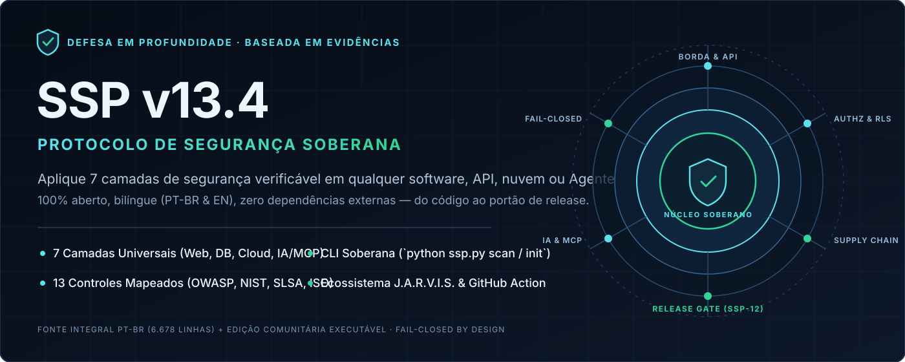
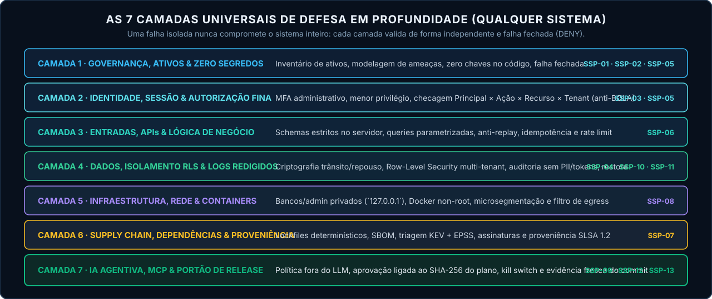
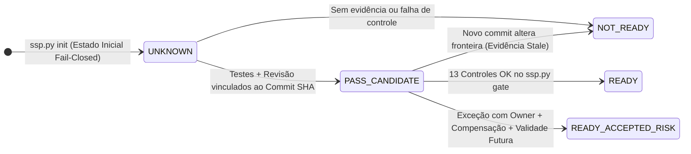

# Protocolo de Segurança Soberana (SSP v13.4) — Camadas de Segurança para Qualquer Sistema

<p align="center">
  
</p>

<p align="center">
  <strong>Framework Aberto de Defesa em Profundidade, 13 Controles Rastreáveis, Playbooks Multi-Stack e Motor CLI Zero-Dependência para Web, APIs, Bancos de Dados, Cloud/Docker e Agentes de IA (MCP)</strong>
</p>

<p align="center">
  <a href="https://github.com/robertoatila/sovereign-security-protocol/actions/workflows/ci.yml"></a>
  <a href="protocol/v13.4/PROTOCOLO_INTEGRAL_v13.4_PT-BR.md"></a>
  <a href="CHANGELOG.md"></a>
  <a href="ssp.py"></a>
  <a href="docs/pt-BR/camadas-por-sistema.md"></a>
  <a href="https://github.com/robertoatila/jarvis-skill-registry"></a>
  <a href="LICENSE"></a>
</p>

<p align="center">
  🇧🇷 <strong>Português (PT-BR)</strong> · <a href="README.en.md">🇺🇸 <strong>Read in English (`README.en.md`)</strong></a>
</p>

<p align="center">
  <a href="protocol/v13.4/PROTOCOLO_INTEGRAL_v13.4_PT-BR.md"><strong>📜 Protocolo Integral (6.678 linhas)</strong></a> ·
  <a href="#-quickstart-em-60-segundos-aplique-em-qualquer-projeto"><strong>⚡ Quickstart (60s)</strong></a> ·
  <a href="docs/pt-BR/camadas-por-sistema.md"><strong>🛡️ Manual das 7 Camadas (Código)</strong></a> ·
  <a href="docs/pt-BR/protocolo.md"><strong>📋 Os 13 Controles</strong></a> ·
  <a href="docs/pt-BR/ecossistema-e-referencias-50k.md"><strong>🧠 J.A.R.V.I.S. &amp; Referências 50k+★</strong></a> ·
  <a href="run_tests.py"><strong>✅ Suíte de Testes</strong></a>
</p>

---

## 📜 Acesso Direto ao Texto Integral da SSP v13.4.0

- **🇧🇷 Fonte Integral em Português (Referência Autoritativa — 6.678 linhas):** **[`protocol/v13.4/PROTOCOLO_INTEGRAL_v13.4_PT-BR.md`](protocol/v13.4/PROTOCOLO_INTEGRAL_v13.4_PT-BR.md)** *(reproduzida byte a byte do commit de origem fixado em [`provenance.md`](docs/research/provenance.md), SHA-256 verificável).*
- **🇺🇸 Tradução Integral Comunitária em Inglês:** **[`protocol/v13.4/SSP_v13.4_FULL_EN_COMMUNITY.md`](protocol/v13.4/SSP_v13.4_FULL_EN_COMMUNITY.md)** *(rascunho automático não canônico para leitura internacional; em caso de divergência, prevalece o texto PT-BR).*

---

## 🌍 Qualquer Pessoa Pode Aplicar em Qualquer Sistema Usando Apenas Este Repositório?

**Sim.** Este repositório foi desenhado para ser **100% autossuficiente, gratuito, offline e agnóstico de linguagem**. Você não precisa contratar plataformas caras, instalar dezenas de pacotes `pip`/`npm` nem enviar seu código para a nuvem:

| Seu Tipo de Sistema | Como Aplicar Apenas com Este Repositório | Artefatos Prontos Inclusos |
| :--- | :--- | :--- |
| **APIs & Apps Web** *(Node/TS, Python, Java, Go, PHP, C#)* | `python ssp.py init --profile web-api` + `ssp.py scan` | Anti-BOLA/IDOR, inicialização Fail-Closed, schemas estritos e idempotência ([ver código](docs/pt-BR/camadas-por-sistema.md)) |
| **SaaS Multi-Tenant & Bancos de Dados** *(PostgreSQL, MySQL)* | `python ssp.py init --profile saas-multitenant` | Isolamento `FORCE ROW LEVEL SECURITY`, separação de roles, logs sem PII e teste de restore |
| **Containers, Linux & Cloud** *(Docker, Compose, K8s, VPS)* | `python ssp.py init --profile microservice` | Correção do bypass Docker/UFW (`127.0.0.1`), containers non-root e bloqueio de egress |
| **Agentes de IA, RAG & MCP** *(OpenAI, Gemini, Claude, Local)* | `python ssp.py init --profile ai-agent-mcp` | `AI_AGENT_MANIFEST.json`, política fora do LLM, aprovação por `SHA-256` do plano e kill-switch |
| **CLI, Mobile & Desktop** *(Rust, Go, Swift, Electron, Tauri)* | `python ssp.py init --profile cli-desktop` | Lockfiles determinísticos, zero segredos hardcoded, proveniência SLSA e atualização íntegra |
| **Pipelines CI/CD no GitHub** *(Qualquer linguagem)* | `uses: robertoatila/sovereign-security-protocol@main` | GitHub Action composta ([`action.yml`](action.yml)) pronta em 5 linhas de YAML |

---

## ⚡ Quickstart em 60 Segundos (Aplique em Qualquer Projeto)

Requer apenas **Python 3.10+** (biblioteca padrão pura — **zero `pip install`**):

```bash
# 1. Clone o repositório e rode o autodiagnóstico criptográfico (SHA-256 + links + schemas):
git clone https://github.com/robertoatila/sovereign-security-protocol.git
cd sovereign-security-protocol
python ssp.py --doctor

# 2. Instale a estrutura das 7 Camadas (.ssp/) em QUALQUER projeto do seu computador:
python ssp.py init --target /caminho/do/seu-projeto --profile web-api --ci

# 3. Escaneie as 7 Camadas de Segurança do seu projeto (100% local e offline):
python ssp.py scan --target /caminho/do/seu-projeto

# 4. Consulte o guia rápido de camadas no terminal ou valide o Portão de Release (SSP-12):
python ssp.py blueprint --lang pt
python ssp.py gate --file /caminho/do/seu-projeto/.ssp/evidence.json --target /caminho/do/seu-projeto
```

### Ou adicione ao GitHub Actions de qualquer repositório em 5 linhas:

```yaml
- uses: actions/checkout@v4
- uses: robertoatila/sovereign-security-protocol@main
  with:
    mode: scan
    target: .
```

---

## 🛡️ Arquitetura Universal: As 7 Camadas & Os 13 Controles

<p align="center">
  
</p>

A edição comunitária organiza os **9 domínios** das 6.678 linhas da fonte em **13 controles auditáveis (`SSP-01` a `SSP-13`)** distribuídos em **7 camadas práticas**:

| ID | Camada | Controle Comunitário | O Que Ele Impede na Prática | Nível Mín. | Padrões Mapeados |
| :---: | :---: | :--- | :--- | :---: | :--- |
| **`SSP-01`** | `L1` | Escopo, ativos e responsabilidade | Ativos órfãos, dados sem dono e mudanças sem revisão de risco | `L1` | NIST PM-5/CM-8 · CIS 1 · ISO A.5.8 |
| **`SSP-02`** | `L1` | Modelagem de ameaças e fronteiras | Confiar cegamente em webhooks, prompts, memória ou dados externos | `L2` | NIST RA-3 · OWASP ASVS V1 |
| **`SSP-03`** | `L2` | Identidade e autorização fina | Roubo de dados entre clientes (**BOLA/IDOR**) e admin sem MFA | `L2` | OWASP ASVS V2-V4 · NIST AC-3/AC-6 |
| **`SSP-04`** | `L4` | Proteção de dados, RLS e privacidade | Vazamento multi-tenant no banco, dados sem criptografia e retenção eterna | `L2` | OWASP ASVS V6/V8 · NIST SC-8/SC-28 |
| **`SSP-05`** | `L1/L2` | Configuração segura e falha fechada | Sistema abrir sem auth quando variável falha (`Fail-Open`) e senhas default | `L2` | OWASP ASVS V14 · CIS 4 · NIST CM-6 |
| **`SSP-06`** | `L3` | Entradas, APIs e lógica de negócio | SQLi, Command Injection, manipulação de preço/saldo e race conditions | `L2` | OWASP ASVS V5/V13 · NIST SI-10 |
| **`SSP-07`** | `L6` | Dependências e integridade de build | Pacotes adulterados, builds sem lockfile e CVEs exploradas (**CISA KEV**) | `L2` | SLSA 1.2 · NIST SR-3 · CIS 2 |
| **`SSP-08`** | `L5` | Infraestrutura, rede e containers | Banco exposto em `0.0.0.0` pelo Docker (bypass de UFW) e container `root` | `L2` | NIST SC-7 · CIS 12 · ISO A.8.20 |
| **`SSP-09`** | `L7` | IA agentiva, memória, RAG e MCP | Prompt injection virando execução shell, tool poisoning e RAG cross-tenant | `L3` | OWASP Agentic 2026 / LLM Top 10 |
| **`SSP-10`** | `L4` | Confiabilidade, mudança e restore | Efeitos duplicados em filas, migrations destrutivas e backups que não restauram | `L2` | NIST CP-4/CP-9 · CIS 11 · ISO A.8.13 |
| **`SSP-11`** | `L4` | Logs redigidos, detecção e resposta | Senhas/tokens gravados em texto puro nos logs e incidentes sem rastro | `L2` | OWASP ASVS V7 · NIST AU-2/IR-4 |
| **`SSP-12`** | `L7` | Verificação e decisão de release | Subir para produção com evidência velha de outro commit ou sem testes | `L3` | NIST CA-2/SA-11 · ISO A.8.29 |
| **`SSP-13`** | `L7` | Acessibilidade, compliance e revisão | Ignorar LGPD/GDPR, acessibilidade (WCAG 2.2 AA) e deriva pós-incidente | `L1` | WCAG 2.2 AA · ISO A.5.31/A.5.36 |

---

## 📐 Invariantes Formais (Por Que o SSP Funciona Onde Checklists Comuns Falham)

Assim como no runtime irmão **[`J.A.R.V.I.S.`](https://github.com/robertoatila/jarvis-skill-registry)**, o SSP substitui suposições informais por três regras determinísticas:

### 1. Ortogonalidade entre Compilar, Escanear e Aprovar (`SSP-12`)
Um projeto compilar ou passar sem alertas em um scanner estático **não significa** que a autorização entre clientes funciona ou que o backup restaura:

$$\texttt{Compila} \;\not\implies\; \texttt{ScannerLimpo} \;\not\implies\; \texttt{READY}$$

Toda aprovação `PASS` exige `Implementação + Teste/Método Adequado + Evidência Fresca` vinculada ao **Commit SHA** e ao **Digest do Artefato** avaliados.



### 2. Autoridade Externa para Agentes de IA & MCP (`SSP-09`)
Um modelo LLM **nunca concede permissão**. A permissão efetiva $\mathcal{A}_{\text{eff}}$ de qualquer chamada de ferramenta ou subagente é calculada **fora do modelo** pela interseção estrita:

$$\mathcal{A}_{\text{eff}} = \mathcal{M}_{\text{missão}} \cap \mathcal{I}_{\text{principal}} \cap \mathcal{P}_{\text{agente}} \cap \mathcal{T}_{\text{tool}} \cap \mathcal{R}_{\text{recurso/tenant}} \cap \mathcal{E}_{\text{ambiente}} \cap \mathcal{B}_{\text{orçamento}}$$

Qualquer ação mutável de alto risco exige consentimento humano assinado sobre o hash `SHA-256` exato do plano (`plan_digest`). Mudou um argumento? A aprovação é invalidada automaticamente.

---

## 💻 Exemplos Práticos: ❌ Comum vs. ✅ Blindado com SSP

Veja exemplos completos em Python, TypeScript/Node.js, PostgreSQL RLS, Docker e Agentes MCP no **[Manual Prático das 7 Camadas (`docs/pt-BR/camadas-por-sistema.md`)](docs/pt-BR/camadas-por-sistema.md)**:

| Cenário Real | ❌ Erro Comum em Produção | ✅ Camada Soberana SSP |
| :--- | :--- | :--- |
| **Variável de Auth ausente** | `os.getenv("REQUIRE_AUTH", "false")` desliga o login silenciosamente | **SSP-05:** Abortar boot em produção se segredo/flag faltar (`Fail-Closed`) |
| **Rota `GET /invoices/:id`** | Verifica apenas se o JWT é válido (permite ler fatura de outro cliente) | **SSP-03 + SSP-04:** `WHERE id = :id AND tenant_id = :tid` + PostgreSQL `FORCE RLS` |
| **Postgres/Redis no Docker** | `ports: ["5432:5432"]` ignora o `ufw` e expõe o banco na Internet | **SSP-08:** `ports: ["127.0.0.1:5432:5432"]` + rede `internal: true` + `USER` non-root |
| **Agente IA com MCP** | Botão `"Permitir"` genérico ou confiança em instruções no system prompt | **SSP-09:** `PolicyEngine` externo + aprovação presa ao `SHA-256` dos argumentos + kill-switch |

---

## 🧠 Conexão com o Ecossistema J.A.R.V.I.S., Obsidian e Projetos 50k+★

- **Ecossistema Irmão [`robertoatila/jarvis-skill-registry`](https://github.com/robertoatila/jarvis-skill-registry):** Enquanto este repositório fornece a especificação aberta SSP v13.4, schemas JSON, playbooks e o scanner/gate universal `ssp.py`, o **J.A.R.V.I.S.** implementa um runtime cognitivo local-first completo com `PolicyEngine (R0–R5)`, orçamento determinístico de contexto em bytes UTF-8 (`compile_context`), `392` skills governadas e gateway MCP Stdio. Os dois funcionam **100% independentes** ou **conectados**.
- **Referências Globais 50k+★:** Veja em **[`docs/pt-BR/ecossistema-e-referencias-50k.md`](docs/pt-BR/ecossistema-e-referencias-50k.md)** como combinar o portão SSP com referências mundiais como `system-design-primer`, `the-book-of-secret-knowledge`, `nodebestpractices`, `PayloadsAllTheThings`, `SecLists` e `Ghidra`.
- **Navegação Visual no Obsidian:** Abra a raiz deste repositório como cofre Obsidian para explorar [`00 - SSP Home.md`](00%20-%20SSP%20Home.md) e o mapa visual [`SSP-13.4.canvas`](SSP-13.4.canvas). *(Nota: o Canvas é apenas visualização humana e não concede autoridade de execução).*

---

## 📚 Mapa Completo da Documentação (PT-BR & EN)

| Recurso | 🇧🇷 Português (PT-BR) | 🇺🇸 English (EN) |
| :--- | :--- | :--- |
| **Protocolo Integral v13.4.0** | [`PROTOCOLO_INTEGRAL_v13.4_PT-BR.md`](protocol/v13.4/PROTOCOLO_INTEGRAL_v13.4_PT-BR.md) *(Referência)* | [`SSP_v13.4_FULL_EN_COMMUNITY.md`](protocol/v13.4/SSP_v13.4_FULL_EN_COMMUNITY.md) *(Draft)* |
| **Manual de Código das 7 Camadas** | [`docs/pt-BR/camadas-por-sistema.md`](docs/pt-BR/camadas-por-sistema.md) | [`docs/en/layers-by-system.md`](docs/en/layers-by-system.md) |
| **Resumo dos 13 Controles** | [`docs/pt-BR/protocolo.md`](docs/pt-BR/protocolo.md) | [`docs/en/protocol.md`](docs/en/protocol.md) |
| **Guia Rápido (Dia 1, Semana 1, Mês 1)** | [`docs/pt-BR/guia-rapido-adocao.md`](docs/pt-BR/guia-rapido-adocao.md) | [`docs/en/quickstart-adoption.md`](docs/en/quickstart-adoption.md) |
| **Fluxo de Evidências & Freshness** | [`docs/pt-BR/adocao-e-evidencias.md`](docs/pt-BR/adocao-e-evidencias.md) | [`docs/en/adoption-and-evidence.md`](docs/en/adoption-and-evidence.md) |
| **Perfil Agentes IA, J.A.R.V.I.S. & MCP** | [`docs/pt-BR/agentes-jarvis-obsidian.md`](docs/pt-BR/agentes-jarvis-obsidian.md) | [`docs/en/agentic-jarvis-obsidian.md`](docs/en/agentic-jarvis-obsidian.md) |
| **Ecossistema & Referências 50k+★** | [`docs/pt-BR/ecossistema-e-referencias-50k.md`](docs/pt-BR/ecossistema-e-referencias-50k.md) | [`docs/en/ecosystem-and-50k-references.md`](docs/en/ecosystem-and-50k-references.md) |
| **Dados Estruturados & Templates** | [`ssp-controls.json`](protocol/v13.4/ssp-controls.json) · [`control-crosswalk.csv`](control-crosswalk.csv) | [`EVIDENCE_RECORD.md`](templates/EVIDENCE_RECORD.md) · [`AI_AGENT_MANIFEST.json`](templates/AI_AGENT_MANIFEST.json) |
| **Proveniência, Fontes & Revisão** | [`provenance.md`](docs/research/provenance.md) · [`NOTICE.md`](protocol/v13.4/NOTICE.md) | [`references.md`](docs/research/references.md) · [`revisao-v13.4.md`](docs/research/revisao-v13.4.md) |

---

## 🧪 Verificação Executável e Bateria de Testes

Valide todas as garantias deste repositório localmente em segundos:

```bash
# 1. Executar a suíte completa de testes unitários e de integração (SHA-256, scanner 7 camadas, gate SSP-12, paridade):
python run_tests.py

# 2. Executar o validador de integridade documental, schemas JSON e links:
python ssp.py validate
```

---

## 🤝 Comunidade, Escopo Honesto e Como Contribuir

- **Escopo e Limites Claros:** A cópia em [`protocol/v13.4/PROTOCOLO_INTEGRAL_v13.4_PT-BR.md`](protocol/v13.4/PROTOCOLO_INTEGRAL_v13.4_PT-BR.md) preserva intacto o texto da SSP v13.4.0 (cujo status `CANÔNICO` pertence ao repositório e commit de origem). Esta **Edição Comunitária `0.3.0`** organiza ferramentas executáveis, guias práticos e traduções sem alegar certificação legal, auditoria concluída de terceiros ou substituição da governança de origem.
- **Como Apoiar e Contribuir:**
  1. **Aplique em seus projetos** usando `python ssp.py init` e relate melhorias reais via Issues/PRs.
  2. **Contribua com novos exemplos de stack** (Rust, Go, Kubernetes, Terraform, Mobile) ou revisão humana da tradução inglesa seguindo [`CONTRIBUTING.md`](CONTRIBUTING.md).
  3. **Compartilhe com sua equipe e marque com ⭐ Star no GitHub** se o protocolo e o scanner ajudarem seu fluxo de engenharia *(estrelas apoiam a descoberta comunitária; segurança real vem da verificação contínua das evidências)*.

Consulte [`CONTRIBUTING.md`](CONTRIBUTING.md), [`VERSIONING.md`](VERSIONING.md), [`SECURITY.md`](SECURITY.md) e [`LICENSE`](LICENSE).
