# J.A.R.V.I.S. Ecosystem & 50k+★ Global Open-Source Benchmarks

> **Language / Idioma:** [🇧🇷 Ler em Português](../pt-BR/ecossistema-e-referencias-50k.md) · 🇺🇸 English

This guide explains how the **Sovereign Security Protocol (`sovereign-security-protocol`)** connects with its sister cognitive runtime **[`robertoatila/jarvis-skill-registry`](https://github.com/robertoatila/jarvis-skill-registry)**, and how it applies clarity, developer ergonomics, and verification patterns inspired by the world's most trusted **50,000+ star** open-source engineering and security repositories.

---

## 1. Sister Architecture: Standalone SSP vs. SSP + J.A.R.V.I.S.

You **do not need any external platform** to adopt SSP: using **only this repository** (`python ssp.py`), any individual developer or engineering team can bootstrap and audit all **7 Security Layers** across Web, Mobile, API, Database, Cloud, or AI systems.

When paired with **[`jarvis-skill-registry`](https://github.com/robertoatila/jarvis-skill-registry)**, the two repositories form a complete local-first architecture separating **Normative Security Policy & Release Gate** from **Autonomous Cognitive Execution & Governed Skills**:

```mermaid
flowchart LR
    subgraph SSP["🛡️ sovereign-security-protocol (This Repo)"]
        P1["Full SSP v13.4 Source (6,678 lines)"]
        P2["13 Controls (SSP-01..SSP-13) + JSON Schema"]
        P3["Universal CLI (ssp.py init / scan / gate)"]
        P4["Reusable GitHub Action (action.yml)"]
    end

    subgraph JARVIS["🧠 jarvis-skill-registry (Cognitive Runtime)"]
        J1["PolicyEngine (Risk Tiers R0–R5)"]
        J2["compile_context() (Deterministic UTF-8 Cap)"]
        J3["VerificationEngine (Execution ⊥ Verification)"]
        J4["Stdio MCP Gateway + 392 Governed Skills"]
    end

    subgraph TARGET["🌍 Any User Software System"]
        T1["Web / SaaS / APIs / RLS Databases"]
        T2["Docker Containers / Cloud / CI"]
        T3["AI Agents / RAG / MCP Servers"]
    end

    SSP -->|"Standalone Mode (Zero Dependencies)"| TARGET
    SSP -->|"SSP-v13.4 Normative Contract"| JARVIS
    JARVIS -->|"Supervised Execution + Receipts"| TARGET
```

| Dimension | `sovereign-security-protocol` (SSP) | `jarvis-skill-registry` (J.A.R.V.I.S.) |
| :--- | :--- | :--- |
| **Core Role** | **7-Layer Security Standard**, Multi-Stack Playbooks, and Commit-Bound Release Gate (`SSP-12`). | **Local-First Cognitive Runtime** for AI Agents, Episodic Memory, and Governed MCP Skills. |
| **Standalone Use?** | **Yes (100% standalone).** Works on any language/stack with Python 3.10+ stdlib only. | **Yes (100% standalone).** Runs 100% offline with local HUD and Stdio JSON-RPC MCP server. |
| **Integration Bridge** | Supplies `SSP-01`..`SSP-13`, `ssp-controls.json`, and the `AI_AGENT_MANIFEST.json` contract. | Enforces `Fail-Closed` policies (`R0`–`R5`), quarantine barriers, and `jarvis_consult_protocol`. |

---

## 2. Design Principles Drawn from 50k+★ Open-Source Landmarks

World-renowned open-source repositories earn community trust by combining **instant visual comprehension**, **copy-pasteable production patterns**, and **immediate day-one utility**. Community Edition `0.3.0` adopts those exact ergonomics and interoperates cleanly with established community tools:

| Global Landmark (50k+★) | Why Developers Love It | How It Feeds Into Your SSP Evidence Package |
| :--- | :--- | :--- |
| **[`donnemartin/system-design-primer`](https://github.com/donnemartin/system-design-primer)** *(270k+★)* | Crystal-clear architecture diagrams, trust boundaries, and reliability/failover trade-offs. | Use zone, queue, cache, and failover diagrams as primary artifacts for **`SSP-01`**, **`SSP-02`**, and **`SSP-10`**. |
| **[`trimstray/the-book-of-secret-knowledge`](https://github.com/trimstray/the-book-of-secret-knowledge)** *(248k+★)* | No-fluff operational CLI manuals for Linux hardening, network inspection, and TLS auditing. | Concrete port, firewall, and TLS verification commands directly support **`SSP-05`** and **`SSP-08`**. |
| **[`Hack-with-Github/Awesome-Hacking`](https://github.com/Hack-with-Github/Awesome-Hacking)** *(122k+★)* | Broad community-curated index of offensive and defensive security verification tools. | Helps security engineers select verification tools before **`SSP-12`** release sign-off. |
| **[`goldbergyoni/nodebestpractices`](https://github.com/goldbergyoni/nodebestpractices)** *(100k+★)* | Side-by-side **❌ Anti-pattern vs ✅ Production Pattern** teaching accessible to all skill levels. | Directly inspires our [7-Layer Practical Manual](layers-by-system.md) comparing vulnerable vs. hardened code. |
| **[`NationalSecurityAgency/ghidra`](https://github.com/NationalSecurityAgency/ghidra)** *(92k+★)* | Sovereign, local-first binary inspection with zero cloud upload requirements. | Deep supply-chain inspection for opaque third-party binaries in high-impact systems (**`SSP-07`**). |
| **[`swisskyrepo/PayloadsAllTheThings`](https://github.com/swisskyrepo/PayloadsAllTheThings)** *(81k+★)* | Battle-tested catalog of real attack payloads (SQLi, SSRF, XSS, BOLA, JWT bypass). | Drives negative integration test suites required to pass **`SSP-03`** and **`SSP-06`**. |
| **[`danielmiessler/SecLists`](https://github.com/danielmiessler/SecLists)** *(74k+★)* | Canonical wordlists for input fuzzing, route discovery, and weak-credential detection. | Empirical verification of rate limits, input boundaries, and shadow endpoints (**`SSP-05`**, **`SSP-06`**). |
| **[`usestrix/strix`](https://github.com/usestrix/strix)** *(67k+★)* | AI-assisted application vulnerability testing and remediation workflows. | Generates security findings while operating under **`SSP-09`** containment and **`SSP-12`** human verification. |

> **Governance & Engineering Honesty Note:** Referencing landmark open-source projects does not imply their endorsement of this repository, nor does running a scanner guarantee security. Under SSP, **tools produce signals; commit-bound evidence verified by an accountable owner authorizes a release**.

---

## 3. Plugging Your Existing Scanners into the `SSP-12` Gate

SSP **never forces you to replace tools your team already trusts** (Trivy, Semgrep, Gitleaks, OWASP ZAP, Nuclei, Playwright, Pytest, Vitest). Instead, SSP acts as the **unifying assurance layer**:

1. **Bootstrap SSP in your repo:** `python ssp.py init --target . --profile web-api --lang en`
2. **Run the zero-dependency 7-layer scan:** `python ssp.py scan --target . --lang en`
3. **Run your stack's negative tests & scanners** (e.g., `pytest tests/security/`, `npm audit`, `trivy fs .`)
4. **Bind the test artifacts and git SHA inside `.ssp/evidence.json`**
5. **Enforce the Release Gate:** `python ssp.py gate --file .ssp/evidence.json --target .`
