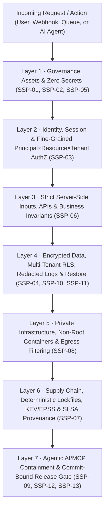

# Practical Manual: Applying the 7 Security Layers to Any System (English)

> **Who is this guide for?** Any developer, software architect, DevSecOps engineer, or AI Agent builder who wants to apply **Defense in Depth** to a real-world system — Web, Mobile, API, Database, Docker/Cloud, CLI, or MCP Agents — using **only this repository**.
>
> **Language / Idioma:** [🇧🇷 Ler em Português](../pt-BR/camadas-por-sistema.md) · 🇺🇸 English

---

## How Layered Defense Works (The Onion Model)

No single control makes a system secure. A firewall does not stop SQL Injection; a valid JWT does not stop cross-customer data theft (BOLA/IDOR); a polite system prompt does not stop an AI agent from exfiltrating secrets through a poisoned MCP tool.

The **Sovereign Security Protocol (SSP v13.4)** organizes its **13 controls (`SSP-01` through `SSP-13`)** into **7 Independent Defense Layers**. If one layer is bypassed, the next layer independently blocks the attack (**Fail-Closed**):



### Bootstrap the 7 Layers in Your Project with 1 Command

```bash
# 1. Initialize .ssp/ scaffolding inside your project (choose a profile):
# Profiles: web-api | saas-multitenant | ai-agent-mcp | microservice | cli-desktop
python ssp.py init --target /path/to/your-project --profile web-api --ci --lang en

# 2. Run the 100% local, zero-dependency 7-layer baseline scanner:
python ssp.py scan --target /path/to/your-project --lang en
```

---

## Layers 1 & 2 — Fail-Closed Configuration & Fine-Grained AuthZ (`SSP-03`, `SSP-05`)

*Applies to: Python (FastAPI/Django), Node.js (Express/Nest/Next.js), Java (Spring Boot), Go, C#, PHP.*

### Golden Rules
1. **Never Fail Open:** If an auth flag or cryptographic key is missing or malformed, the service **MUST refuse to boot** or deny every request (`401`/`500`) — never silently run unauthenticated.
2. **Identity $\neq$ Authorization:** A valid session or JWT does not authorize reading another customer's `invoice_id` or `tenant_id` (OWASP API1 — **BOLA/IDOR**).

### ❌ Vulnerable (Common) vs ✅ Hardened with SSP

```python
# ❌ VULNERABLE: Fails open when REQUIRE_AUTH is unset + no tenant scoping (BOLA/IDOR)
import os

REQUIRE_AUTH = os.getenv("REQUIRE_AUTH", "false").lower() == "true"  # Danger: defaults to false!

def get_invoice(db, invoice_id: str, current_user):
    if REQUIRE_AUTH and not current_user:
        raise PermissionError("Unauthorized")
    # Any logged-in user can read another company's invoice!
    return db.query("SELECT * FROM invoices WHERE id = :id", {"id": invoice_id})
```

```python
# ✅ HARDENED (SSP-03 + SSP-05): Fail-closed startup + Principal × Resource × Tenant check
import os

def load_required_secret(name: str) -> str:
    val = os.getenv(name, "").strip()
    if len(val) < 32:
        raise RuntimeError(f"[SSP-05 FAIL-CLOSED] Critical secret '{name}' missing or too weak.")
    return val

if os.getenv("APP_ENV", "production") == "production" and os.getenv("REQUIRE_AUTH", "true") != "true":
    raise RuntimeError("[SSP-05 FAIL-CLOSED] Authentication cannot be disabled in production.")

def get_invoice(db, invoice_id: str, principal) -> dict:
    if not principal or not principal.is_authenticated or not principal.tenant_id:
        raise PermissionError("[SSP-03] Unauthenticated principal")
    if "invoice:read" not in principal.permissions:
        raise PermissionError("[SSP-03] Missing 'invoice:read' capability")

    # Enforce tenant_id directly inside the data-access predicate
    row = db.query_one(
        "SELECT id, amount_cents, status FROM invoices WHERE id = :id AND tenant_id = :tid",
        {"id": invoice_id, "tid": principal.tenant_id},
    )
    if row is None:
        raise LookupError("Invoice not found")  # Prevents cross-tenant enumeration
    return row
```

---

## Layer 3 — Inputs, APIs & Business Invariants (`SSP-06`)

*Applies to: REST, GraphQL, gRPC, Webhooks, Queues, and Financial/State Workflows.*

### Golden Rules
- Clients (browsers, mobile apps, external webhooks, or LLMs) **are never authoritative for price, balance, role, `tenant_id`, or privileged state**.
- Every financial or state-mutating endpoint requires an **idempotency key** and atomic server-side invariants to defeat race conditions and replay attacks.

### ❌ Vulnerable vs ✅ Hardened with SSP (Node.js / TypeScript)

```typescript
// ❌ VULNERABLE: Trusts client-supplied price (Mass Assignment) and lacks idempotency
app.post("/api/checkout", async (req, res) => {
  const { itemId, priceCents, discountPercent } = req.body; // Attacker sends priceCents: 1!
  await chargeCard(req.user.id, priceCents * (1 - discountPercent / 100));
  res.json({ ok: true });
});
```

```typescript
// ✅ HARDENED (SSP-06): Strict allow-list schema, server-authoritative pricing & idempotency
import { z } from "zod";

const CheckoutSchema = z.object({
  itemId: z.string().uuid(),
  quantity: z.number().int().min(1).max(20),
  idempotencyKey: z.string().min(16).max(64),
}).strict(); // Rejects unexpected fields like role or priceCents

app.post("/api/checkout", requireAuth, rateLimit({ max: 10, windowMs: 60_000 }), async (req, res) => {
  const input = CheckoutSchema.parse(req.body);
  const item = await catalogRepo.findActiveById(input.itemId); // Server is sole price authority
  const totalCents = item.unitPriceCents * input.quantity;

  const receipt = await paymentService.chargeIdempotent({
    principalId: req.principal.id,
    tenantId: req.principal.tenantId,
    idempotencyKey: input.idempotencyKey,
    amountCents: totalCents,
  });
  res.status(200).json({ orderId: receipt.orderId, status: receipt.status });
});
```

---

## Layer 4 — Databases, Multi-Tenant RLS, Redacted Logs & Recovery (`SSP-04`, `SSP-10`, `SSP-11`)

*Applies to: PostgreSQL, Supabase, MySQL, SQL Server, MongoDB, and Observability Pipelines.*

### Golden Rules
- **Database-Enforced Isolation (`Row-Level Security`):** Even if an application route forgets a `WHERE tenant_id = ...` filter, PostgreSQL itself blocks cross-tenant data leakage!
- **Untested Backup = `UNKNOWN`:** Having automated snapshots is not `PASS` for `SSP-10`; run scheduled restore drills in an isolated environment and record actual RTO/RPO.

### ✅ Multi-Tenant PostgreSQL Hardening (`SSP-04`)

```sql
-- 1. Enable and FORCE Row-Level Security (applies even to table owners)
ALTER TABLE customer_records ENABLE ROW LEVEL SECURITY;
ALTER TABLE customer_records FORCE ROW LEVEL SECURITY;

-- 2. Fail-Closed Policy: if app.current_tenant is unset in the transaction, 0 rows are returned!
CREATE POLICY tenant_isolation_policy ON customer_records
    USING (tenant_id = NULLIF(current_setting('app.current_tenant', true), '')::uuid)
    WITH CHECK (tenant_id = NULLIF(current_setting('app.current_tenant', true), '')::uuid);

-- 3. Inside every application transaction:
-- BEGIN;
-- SELECT set_config('app.current_tenant', $1, true); -- transaction-scoped (true)
-- SELECT * FROM customer_records;
-- COMMIT;
```

---

## Layer 5 — Infrastructure, Non-Root Containers & Private Networking (`SSP-08`)

*Applies to: Docker, Docker Compose, Kubernetes, Linux Servers (UFW/nftables), AWS/GCP/Azure.*

### Golden Rule (The Classic Docker Firewall Bypass!)
Publishing `ports: ["5432:5432"]` in `docker-compose.yml` injects `DNAT` rules directly into Linux `iptables`, **completely bypassing `ufw` host firewalls** and exposing your database to the public Internet! Bind internal databases strictly to `127.0.0.1` loopback or `internal: true` networks.

### ❌ Vulnerable vs ✅ Hardened with SSP (`docker-compose.yml`)

```yaml
# ❌ VULNERABLE: Mutable :latest tag, runs as root, and exposes Postgres on 0.0.0.0!
services:
  db:
    image: postgres:latest
    ports:
      - "5432:5432" # EXPOSED TO PUBLIC WAN BYPASSING UFW!
    environment:
      POSTGRES_PASSWORD: admin
```

```yaml
# ✅ HARDENED (SSP-05 + SSP-08): Pinned image, isolated internal network, loopback bind & non-root
services:
  api:
    build:
      context: .
      dockerfile: Dockerfile
    user: "10001:10001"
    read_only: true
    tmpfs: ["/tmp"]
    cap_drop: ["ALL"]
    security_opt: ["no-new-privileges:true"]
    networks: ["edge_net", "db_private_net"]

  db:
    image: postgres:16.4-alpine
    ports:
      - "127.0.0.1:5432:5432" # Reachable only locally or via SSH/ZTNA tunnel, never WAN!
    environment:
      POSTGRES_PASSWORD_FILE: /run/secrets/db_password
    networks: ["db_private_net"]

networks:
  edge_net: {}
  db_private_net:
    internal: true # Blocks direct database egress to the Internet
```

---

## Layer 6 — Supply Chain, Lockfiles & Build Provenance (`SSP-07`)

*Applies to: npm/pnpm, pip/uv/poetry, Cargo, Go modules, Maven/Gradle, and GitHub Actions.*

- **Deterministic CI Installs:** Use `npm ci` (never `npm install`), `pip install --require-hashes` / `uv sync --frozen`, `cargo build --locked`.
- **Pinned CI Actions:** Pin third-party GitHub Actions to full 40-char commit SHAs (`uses: actions/checkout@11bd71901bbe5b1630ceea73d27597364c9af683 # v4.2.2`).
- **Context-Driven Vulnerability Triage:** Prioritize **[CISA KEV](https://www.cisa.gov/known-exploited-vulnerabilities-catalog)** + high **EPSS** + reachable production attack paths rather than drowning in unexploitable noise.

---

## Layer 7 — Agentic AI, RAG, MCP & Release Gate (`SSP-09`, `SSP-12`)

*Applies to: LLM Agents (OpenAI, Gemini, Claude, Ollama), MCP Servers, LangGraph/CrewAI, and Sovereign Runtimes like **[J.A.R.V.I.S.](https://github.com/robertoatila/jarvis-skill-registry)**.*

### The 4 Golden Laws for Agentic AI (`SSP-09`)
1. **The Model Grants Zero Authority:** LLM output is an *untrusted tool proposal*, never an authorization token. A deterministic `PolicyEngine` **outside the model** enforces `Principal ∩ Mission ∩ Tool ∩ Resource ∩ Tenant ∩ Budget`.
2. **Digest-Bound Human Approval (`plan_digest`):** For high-risk actions (deleting data, sending external emails, deploying, transferring funds), a generic `"Approve"` boolean click is invalid. The approval receipt must bind to the exact `SHA-256` digest of `(principal, tenant, tool, args)` + expiration. If 1 byte changes, consent is void!
3. **Pre-Query Tenant Filtering in RAG:** Never retrieve vectors across all tenants and ask the LLM to ignore unauthorized rows. Enforce `tenant_id == principal.tenant_id` **inside the vector store query filter**.
4. **Hard Budgets & Kill Switch:** Enforce wall-clock timeouts, recursion depth caps, token/byte budgets, and an immediate operational kill switch.

```python
# ✅ HARDENED (SSP-09): External deterministic policy check with SHA-256 plan-digest approval
import hashlib, json, time

def authorize_agent_tool_call(principal, tool_name: str, args: dict, approval_receipt: dict | None) -> None:
    canonical_payload = json.dumps(
        {"principal": principal.id, "tenant": principal.tenant_id, "tool": tool_name, "args": args},
        sort_keys=True,
        separators=(",", ":"),
    ).encode("utf-8")
    plan_digest = hashlib.sha256(canonical_payload).hexdigest()

    if tool_name not in principal.allowed_mcp_tools:
        raise PermissionError(f"[SSP-09] Tool '{tool_name}' denied by external policy.")

    if tool_name in {"db.drop", "fs.delete", "cloud.deploy", "billing.transfer"}:
        if not approval_receipt:
            raise PermissionError(f"[SSP-09] High-risk action requires human approval for digest {plan_digest}")
        if approval_receipt.get("plan_digest") != plan_digest:
            raise PermissionError("[SSP-09] Approval invalidated: payload changed after human consent!")
        if approval_receipt.get("expires_at_epoch", 0) < time.time():
            raise PermissionError("[SSP-09] Approval receipt expired!")
```

---

## Closing the Loop: The Release Gate (`SSP-12`)

Before promoting any release candidate to production, run both sovereign commands from this repository:

```bash
# 1. Automated 7-layer baseline scan:
python ssp.py scan --target /path/to/your-project --strict --lang en

# 2. Formal SSP-12 Release Gate bound to your exact git HEAD commit SHA:
python ssp.py gate --file /path/to/your-project/.ssp/evidence.json --target /path/to/your-project
```

Any `FAIL`, `UNKNOWN`, expired risk exception, or stale commit SHA (`STALE_EVIDENCE`) triggers exit code `2` (`NOT READY`) — giving you **verifiable, fail-closed security across any stack**.
