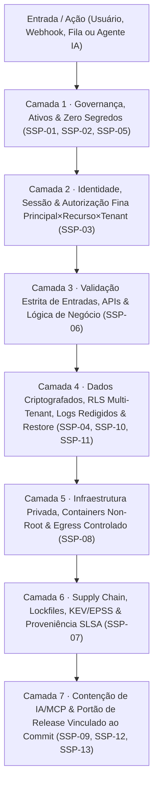

# Manual Prático: Aplicando as 7 Camadas de Segurança em Qualquer Sistema (PT-BR)

> **Para quem é este guia?** Qualquer pessoa desenvolvedora, arquiteta, engenheira DevSecOps ou criadora de Agentes de IA que queira aplicar **Defesa em Profundidade (Defense in Depth)** em um projeto real — Web, Mobile, API, Banco de Dados, Docker/Cloud, CLI ou Agentes MCP — usando **apenas este repositório**.
>
> **Idioma / Language:** 🇧🇷 Português (PT-BR) · [🇺🇸 Read in English](../en/layers-by-system.md)

---

## Como Funciona a Defesa em Camadas (Modelo Cebola)

Nenhum controle único torna um sistema seguro. Firewalls não impedem SQL Injection; JWT válido não impede acesso aos dados de outro cliente (BOLA/IDOR); um LLM "bem instruído" no prompt não impede exfiltração via ferramenta MCP.

O **Protocolo de Segurança Soberana (SSP v13.4)** organiza seus **13 controles (`SSP-01` a `SSP-13`)** em **7 Camadas Independentes**. Se uma camada falhar, a camada seguinte bloqueia o ataque (**Fail-Closed**):



### Instale as Camadas no Seu Projeto em 1 Comando

```bash
# 1. Inicialize a estrutura .ssp/ no seu sistema (escolha o perfil):
# Perfis: web-api | saas-multitenant | ai-agent-mcp | microservice | cli-desktop
python ssp.py init --target /caminho/do/seu-projeto --profile web-api --ci

# 2. Escaneie automaticamente as 7 camadas (100% local e offline):
python ssp.py scan --target /caminho/do/seu-projeto
```

---

## Camada 1 & 2 — Configuração Fail-Closed e Autorização Fina (`SSP-03`, `SSP-05`)

*Aplicável a: Python (FastAPI/Django), Node.js (Express/Nest/Next.js), Java (Spring Boot), Go, C#, PHP.*

### Regra de Ouro
1. **Nunca falhe aberto (`Fail-Open`):** Se uma variável de ambiente de autenticação ou chave criptográfica estiver ausente, a aplicação **MUST abortar na inicialização** ou negar todas as requisições (`401`/`500`), jamais operar em modo "sem auth".
2. **Identidade $\neq$ Autorização:** Estar logado (JWT válido) não dá direito de ler ou alterar o `invoice_id` de outro usuário ou `tenant_id` (vulnerabilidade #1 em APIs: **OWASP API1 — BOLA/IDOR**).

### ❌ Vulnerável (Comum) vs ✅ Blindado com SSP

```python
# ❌ VULNERÁVEL: Falha aberta se REQUIRE_AUTH sumir + busca sem escopo de tenant (BOLA/IDOR)
import os

REQUIRE_AUTH = os.getenv("REQUIRE_AUTH", "false").lower() == "true"  # Perigo: default false!

def get_invoice(db, invoice_id: str, current_user):
    if REQUIRE_AUTH and not current_user:
        raise PermissionError("Unauthorized")
    # Qualquer usuário autenticado consegue ler a fatura de outra empresa!
    return db.query("SELECT * FROM invoices WHERE id = :id", {"id": invoice_id})
```

```python
# ✅ BLINDADO (SSP-03 + SSP-05): Inicialização Fail-Closed + Autorização Principal × Recurso × Tenant
import os

def load_required_secret(name: str) -> str:
    val = os.getenv(name, "").strip()
    if len(val) < 32:
        raise RuntimeError(f"[SSP-05 FAIL-CLOSED] Critical secret '{name}' missing or too weak.")
    return val

# Falha fechado por padrão: só desativa em teste local explícito e isolado
if os.getenv("APP_ENV", "production") == "production" and os.getenv("REQUIRE_AUTH", "true") != "true":
    raise RuntimeError("[SSP-05 FAIL-CLOSED] Authentication cannot be disabled in production.")

def get_invoice(db, invoice_id: str, principal) -> dict:
    if not principal or not principal.is_authenticated or not principal.tenant_id:
        raise PermissionError("[SSP-03] Unauthenticated principal")
    if "invoice:read" not in principal.permissions:
        raise PermissionError("[SSP-03] Missing 'invoice:read' capability")

    # Autorização vinculada na própria query ao tenant_id do principal autenticado
    row = db.query_one(
        "SELECT id, amount_cents, status FROM invoices WHERE id = :id AND tenant_id = :tid",
        {"id": invoice_id, "tid": principal.tenant_id},
    )
    if row is None:
        raise LookupError("Invoice not found")  # Evita enumeração entre tenants
    return row
```

---

## Camada 3 — Entradas, APIs e Invariantes de Negócio (`SSP-06`)

*Aplicável a: REST, GraphQL, gRPC, Webhooks, Filas e Pagamentos.*

### Regra de Ouro
- O cliente (browser, app mobile, webhook externo ou LLM) **nunca decide preço, saldo, role, `tenant_id` ou estado privilegiado**.
- Toda mutação financeira ou crítica exige **chave de idempotência** e transação atômica com trava contra condição de corrida (*race condition / double-spend*).

### ❌ Vulnerável vs ✅ Blindado com SSP (Node.js / TypeScript)

```typescript
// ❌ VULNERÁVEL: Confia no preço/role enviado pelo cliente (Mass Assignment) e sem idempotência
app.post("/api/checkout", async (req, res) => {
  const { itemId, priceCents, discountPercent } = req.body; // Atacante envia priceCents: 1!
  await chargeCard(req.user.id, priceCents * (1 - discountPercent / 100));
  res.json({ ok: true });
});
```

```typescript
// ✅ BLINDADO (SSP-06): Schema estrito (allow-list), preço lido do servidor e idempotência
import { z } from "zod";

const CheckoutSchema = z.object({
  itemId: z.string().uuid(),
  quantity: z.number().int().min(1).max(20),
  idempotencyKey: z.string().min(16).max(64),
}).strict(); // Rejeita campos extras inesperados (como role ou priceCents)

app.post("/api/checkout", requireAuth, rateLimit({ max: 10, windowMs: 60_000 }), async (req, res) => {
  const input = CheckoutSchema.parse(req.body);
  const item = await catalogRepo.findActiveById(input.itemId); // Autoridade exclusiva do servidor
  const totalCents = item.unitPriceCents * input.quantity;

  const receipt = await paymentService.chargeIdempotent({
    principalId: req.principal.id,
    tenantId: req.principal.tenantId,
    idempotencyKey: input.idempotencyKey,
    amountCents: totalCents,
  });
  res.status(200).json({ orderId: receipt.orderId, status: receipt.status });
});
```

---

## Camada 4 — Banco de Dados, Isolamento RLS, Logs Redigidos e Backup (`SSP-04`, `SSP-10`, `SSP-11`)

*Aplicável a: PostgreSQL, Supabase, MySQL, SQL Server, MongoDB e Pipelines de Observabilidade.*

### Regra de Ouro
- **Defesa no Banco (`Row-Level Security`):** Mesmo que um dev esqueça um `WHERE tenant_id = ...` no código da API, o próprio PostgreSQL bloqueia vazamento cruzado entre clientes!
- **Backup sem teste de restore = `UNKNOWN`:** Ter snapshot automático não é `PASS` no `SSP-10`; exercite a restauração em ambiente isolado e meça o tempo real (RTO/RPO).

### ✅ Blindagem PostgreSQL Multi-Tenant (`SSP-04`)

```sql
-- 1. Ativar e FORÇAR Row-Level Security (aplica inclusive ao dono da tabela)
ALTER TABLE customer_records ENABLE ROW LEVEL SECURITY;
ALTER TABLE customer_records FORCE ROW LEVEL SECURITY;

-- 2. Política Fail-Closed: se app.current_tenant não estiver definido na transação, retorna 0 linhas!
CREATE POLICY tenant_isolation_policy ON customer_records
    USING (tenant_id = NULLIF(current_setting('app.current_tenant', true), '')::uuid)
    WITH CHECK (tenant_id = NULLIF(current_setting('app.current_tenant', true), '')::uuid);

-- 3. Na transação da aplicação:
-- BEGIN;
-- SELECT set_config('app.current_tenant', $1, true); -- escopo local à transação (true)
-- SELECT * FROM customer_records;
-- COMMIT;
```

---

## Camada 5 — Infraestrutura, Containers Non-Root e Rede Privada (`SSP-08`)

*Aplicável a: Docker, Docker Compose, Kubernetes, VPS Linux (UFW/nftables), AWS/GCP/Azure.*

### Regra de Ouro (Armadilha Clássica do Docker!)
Publicar `ports: ["5432:5432"]` no `docker-compose.yml` escreve regras `DNAT` direto no `iptables` do Linux, **ignorando completamente o `ufw` (firewall do host)** e expondo seu PostgreSQL/Redis para toda a Internet! Vincule serviços internos exclusivamente ao loopback `127.0.0.1` ou a redes internas `internal: true`.

### ❌ Vulnerável vs ✅ Blindado com SSP (`Dockerfile` + `docker-compose.yml`)

```yaml
# ❌ VULNERÁVEL: Imagem :latest, container rodando como root e Postgres exposto em 0.0.0.0!
services:
  db:
    image: postgres:latest
    ports:
      - "5432:5432" # EXPÕE NA INTERNET IGNORANDO O UFW!
    environment:
      POSTGRES_PASSWORD: admin
```

```yaml
# ✅ BLINDADO (SSP-05 + SSP-08): Imagem fixada, rede interna isolada, loopback 127.0.0.1 e non-root
services:
  api:
    build:
      context: .
      dockerfile: Dockerfile
    user: "10001:10001"
    read_only: true
    tmpfs: ["/tmp"]
    cap_drop: ["ALL"]
    security_opt: ["no-new-privileges:true"]
    networks: ["edge_net", "db_private_net"]

  db:
    image: postgres:16.4-alpine
    ports:
      - "127.0.0.1:5432:5432" # Acessível apenas localmente via túnel SSH/bastion, nunca na WAN!
    environment:
      POSTGRES_PASSWORD_FILE: /run/secrets/db_password
    networks: ["db_private_net"]

networks:
  edge_net: {}
  db_private_net:
    internal: true # Bloqueia egress direto do banco para a Internet
```

---

## Camada 6 — Supply Chain, Lockfiles e Proveniência de Build (`SSP-07`)

*Aplicável a: npm/pnpm, pip/uv/poetry, Cargo, Go modules, Maven/Gradle e GitHub Actions.*

- **Instalações determinísticas em CI:** Use `npm ci` (nunca `npm install`), `pip install --require-hashes` / `uv sync --frozen`, `cargo build --locked`.
- **Actions e Imagens fixadas:** Fixe actions de terceiros pelo hash SHA de 40 caracteres (`uses: actions/checkout@11bd71901bbe5b1630ceea73d27597364c9af683 # v4.2.2`).
- **Triagem Inteligente de CVEs:** Priorize vulnerabilidades presentes no catálogo **[CISA KEV](https://www.cisa.gov/known-exploited-vulnerabilities-catalog)** + alto **EPSS** + caminho alcançável em produção, em vez de tratar milhares de alertas teóricos sem contexto.

---

## Camada 7 — Agentes de IA, RAG, MCP e Portão de Release (`SSP-09`, `SSP-12`)

*Aplicável a: Agentes LLM (OpenAI, Gemini, Claude, Ollama), Servidores MCP, LangGraph/CrewAI e Runtimes Soberanos como o **[J.A.R.V.I.S.](https://github.com/robertoatila/jarvis-skill-registry)**.*

### As 4 Leis de Ouro para IA Agentiva (`SSP-09`)
1. **O Modelo Nunca É Autoridade:** O texto gerado pelo LLM é uma *proposta de chamada*, nunca uma permissão. Um `PolicyEngine` determinístico **fora do modelo** valida `Principal ∩ Missão ∩ Ferramenta ∩ Recurso ∩ Tenant ∩ Orçamento`.
2. **Aprovação Humana Vinculada ao Digest (`plan_digest`):** Para ações de risco (deletar dados, enviar e-mail externo, deploy, transferência), um botão `"Sim"` genérico é inválido. O recibo de aprovação deve assinar o `SHA-256` exato da ferramenta + argumentos + alvo + expiração. Se 1 byte mudar, a aprovação é invalidada!
3. **RAG com Filtro Pré-Busca por Tenant:** Nunca recupere documentos de todos os clientes no banco vetorial para "pedir ao LLM filtrar depois". Aplique o filtro `tenant_id == principal.tenant_id` **dentro da query do banco vetorial**.
4. **Orçamento + Kill Switch:** Defina teto rígido de tempo, iterações, custo/bytes e parada imediata de subagentes.

```python
# ✅ BLINDADO (SSP-09): Verificador determinístico fora do LLM com digest SHA-256 do plano
import hashlib, json, time

def authorize_agent_tool_call(principal, tool_name: str, args: dict, approval_receipt: dict | None) -> None:
    canonical_payload = json.dumps(
        {"principal": principal.id, "tenant": principal.tenant_id, "tool": tool_name, "args": args},
        sort_keys=True,
        separators=(",", ":"),
    ).encode("utf-8")
    plan_digest = hashlib.sha256(canonical_payload).hexdigest()

    if tool_name not in principal.allowed_mcp_tools:
        raise PermissionError(f"[SSP-09] Tool '{tool_name}' denied by external policy.")

    if tool_name in {"db.drop", "fs.delete", "cloud.deploy", "billing.transfer"}:
        if not approval_receipt:
            raise PermissionError(f"[SSP-09] High-risk action requires human approval for digest {plan_digest}")
        if approval_receipt.get("plan_digest") != plan_digest:
            raise PermissionError("[SSP-09] Approval invalidated: payload changed after human consent!")
        if approval_receipt.get("expires_at_epoch", 0) < time.time():
            raise PermissionError("[SSP-09] Approval receipt expired!")
```

---

## Fechando o Ciclo: O Portão de Release (`SSP-12`)

Antes de colocar qualquer versão em produção, rode os dois comandos soberanos deste repositório:

```bash
# 1. Varredura heurística das 7 camadas:
python ssp.py scan --target /caminho/do/seu-projeto --strict

# 2. Validação formal do pacote de evidências vinculado ao commit SHA exato de release:
python ssp.py gate --file /caminho/do/seu-projeto/.ssp/evidence.json --target /caminho/do/seu-projeto
```

Se houver qualquer controle crítico em `FAIL`, `UNKNOWN`, exceção vencida ou evidência de um commit antigo (`STALE_EVIDENCE`), o portão retorna código de saída `2` (`NOT READY`) — garantindo **Segurança Fail-Closed verificável em qualquer sistema**.
