# Ecossistema J.A.R.V.I.S. & Referências Globais Open-Source (50k+★)

> **Idioma / Language:** 🇧🇷 Português (PT-BR) · [🇺🇸 Read in English](../en/ecosystem-and-50k-references.md)

Este documento explica como o **Protocolo de Segurança Soberana (`sovereign-security-protocol`)** se conecta ao runtime cognitivo **[`robertoatila/jarvis-skill-registry`](https://github.com/robertoatila/jarvis-skill-registry)** e como ele aplica princípios de clareza, utilidade prática e verificação inspirados nos maiores projetos open-source de engenharia e segurança do GitHub (**50.000+ estrelas**).

---

## 1. Arquitetura Irmã: SSP Standalone vs. SSP + J.A.R.V.I.S.

Você **não precisa instalar mais nada** para usar o SSP: apenas com este repositório (`python ssp.py`), você aplica e audita as **7 Camadas de Segurança** em qualquer sistema Web, Mobile, API, Cloud ou IA.

Quando combinado ao **[`jarvis-skill-registry`](https://github.com/robertoatila/jarvis-skill-registry)**, os dois projetos formam uma arquitetura soberana completa separando **Norma & Portão de Release** de **Execução Cognitiva & Arsenal de Skills**:

```mermaid
flowchart LR
    subgraph SSP["🛡️ sovereign-security-protocol (Este Repo)"]
        P1["Protocolo Integral v13.4 (6.678 linhas)"]
        P2["13 Controles (SSP-01..SSP-13) + JSON Schema"]
        P3["CLI Universal (ssp.py init / scan / gate)"]
        P4["GitHub Action Reutilizável (action.yml)"]
    end

    subgraph JARVIS["🧠 jarvis-skill-registry (Runtime Cognitivo)"]
        J1["PolicyEngine (Escala de Risco R0–R5)"]
        J2["compile_context() (Teto Determinístico UTF-8)"]
        J3["VerificationEngine (Execução ⊥ Verificação)"]
        J4["Gateway MCP Stdio + 392 Skills Governadas"]
    end

    subgraph TARGET["🌍 Qualquer Sistema do Usuário"]
        T1["Web / SaaS / APIs / Bancos RLS"]
        T2["Containers Docker / Cloud / CI"]
        T3["Agentes de IA / RAG / Servidores MCP"]
    end

    SSP -->|"Modo Standalone (Zero Dependências)"| TARGET
    SSP -->|"Contrato Normativo SSP-v13.4"| JARVIS
    JARVIS -->|"Execução Supervisionada + Recibos"| TARGET
```

| Dimensão | `sovereign-security-protocol` (SSP) | `jarvis-skill-registry` (J.A.R.V.I.S.) |
| :--- | :--- | :--- |
| **Papel Principal** | **Padrão de Segurança em 7 Camadas**, Playbooks Multi-Stack e Portão de Release (`SSP-12`). | **Runtime Cognitivo Local-First** para Agentes de IA, Memória Episódica e Catálogo de Skills MCP. |
| **Uso Independente?** | **Sim (100% autônomo).** Roda em qualquer linguagem/stack apenas com Python 3.10+ stdlib. | **Sim (100% autônomo).** Opera 100% offline com HUD local e servidor JSON-RPC Stdio. |
| **Ponto de Conexão** | Fornece os controles `SSP-01`..`SSP-13`, `ssp-controls.json` e o contrato `AI_AGENT_MANIFEST.json`. | Aplica políticas `Fail-Closed` (`R0`–`R5`), barreira de quarentena e `jarvis_consult_protocol`. |

---

## 2. O Que Aprendemos com Repositórios Globais de 50k+ Estrelas

Projetos open-source lendários alcançam adoção mundial quando unem **didática visual imediata**, **exemplos práticos copiáveis** e **utilidade real no dia a dia**. A estrutura desta Edição Comunitária `0.3.0` incorpora esses pilares e se integra diretamente às ferramentas consagradas pela comunidade:

| Referência Global (50k+★) | Por que a Comunidade Apoia | Como Conectar ao Seu Pacote de Evidências SSP |
| :--- | :--- | :--- |
| **[`donnemartin/system-design-primer`](https://github.com/donnemartin/system-design-primer)** *(270k+★)* | Diagramas claros de arquitetura, fronteiras e trade-offs de escalabilidade e resiliência. | Use seus diagramas de zonas, filas, cache e failover como base para evidências de **`SSP-01`**, **`SSP-02`** e **`SSP-10`**. |
| **[`trimstray/the-book-of-secret-knowledge`](https://github.com/trimstray/the-book-of-secret-knowledge)** *(248k+★)* | Manual operacional direto ao ponto para hardening Linux, rede, TLS e auditoria CLI. | Comandos práticos de inspeção de portas, certificados TLS e hardening de host alimentam **`SSP-05`** e **`SSP-08`**. |
| **[`Hack-with-Github/Awesome-Hacking`](https://github.com/Hack-with-Github/Awesome-Hacking)** *(122k+★)* | Curadoria comunitária abrangente de ferramentas de teste de intrusão e defesa. | Repertório de ferramentas de auditoria para validar superfícies expostas antes do release (**`SSP-12`**). |
| **[`goldbergyoni/nodebestpractices`](https://github.com/goldbergyoni/nodebestpractices)** *(100k+★)* | Pedagogia lado a lado **❌ Anti-padrão vs ✅ Prática de Produção** acessível para qualquer nível. | Inspira diretamente nosso [Manual das 7 Camadas](camadas-por-sistema.md) com código vulnerável vs. blindado. |
| **[`NationalSecurityAgency/ghidra`](https://github.com/NationalSecurityAgency/ghidra)** *(92k+★)* | Ferramenta soberana local-first de inspeção binária profunda sem envio de código para nuvem. | Auditoria reversa de binários/dependências opacas em ambientes críticos (**`SSP-07`**). |
| **[`swisskyrepo/PayloadsAllTheThings`](https://github.com/swisskyrepo/PayloadsAllTheThings)** *(81k+★)* | Catálogo prático de vetores reais (SQLi, SSRF, XSS, BOLA, JWT bypass) para testes negativos. | Fonte direta de casos negativos automatizados exigidos para aprovar **`SSP-03`** e **`SSP-06`**. |
| **[`danielmiessler/SecLists`](https://github.com/danielmiessler/SecLists)** *(74k+★)* | Listas canônicas para fuzzing de entradas, descoberta de rotas ocultas e auditoria de senhas fracas. | Validação empírica de limites de entrada, rate-limiting e ausência de rotas órfãs (**`SSP-05`**, **`SSP-06`**). |
| **[`usestrix/strix`](https://github.com/usestrix/strix)** *(67k+★)* | Testes de segurança assistidos por IA para encontrar e corrigir falhas em aplicações. | Pode gerar insumos de revisão, sempre submetidos à contenção **`SSP-09`** e validação humana **`SSP-12`**. |

> **Nota de Governança e Honestidade Técnica:** Referenciar projetos consagrados não transfere endosso deles para este repositório, nem substitui testes no seu próprio código. No SSP, **ferramentas geram sinais; evidência vinculada ao commit SHA e revisada pelo responsável aprova o release**.

---

## 3. Como Usar Suas Ferramentas Favoritas Dentro do Gate `SSP-12`

O SSP **não obriga você a abandonar as ferramentas que sua equipe já ama** (Trivy, Semgrep, Gitleaks, OWASP ZAP, Nuclei, Playwright, Pytest, Vitest). Pelo contrário: o SSP funciona como a **camada unificadora de decisão**:

1. **Inicialize o SSP no projeto:** `python ssp.py init --target . --profile web-api`
2. **Rode a varredura base zero-dependência:** `python ssp.py scan --target .`
3. **Rode os testes e scanners da sua stack** (ex.: `pytest tests/security/`, `npm audit`, `trivy fs .`)
4. **Registre os artefatos e o commit SHA em `.ssp/evidence.json`**
5. **Valide o Portão de Release:** `python ssp.py gate --file .ssp/evidence.json --target .`
